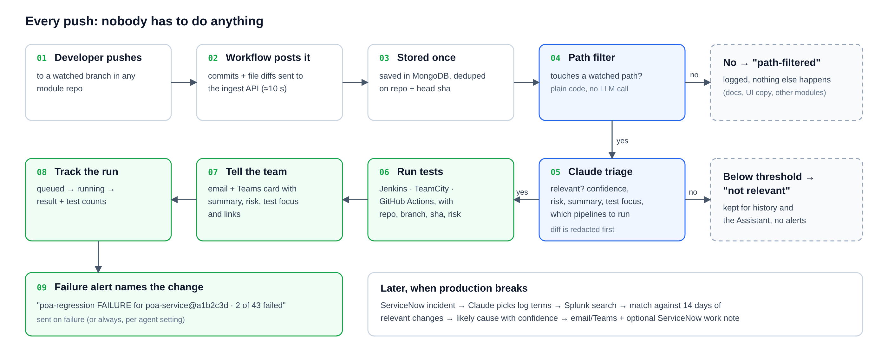

# Overview

## The problem

The discretion module (POA, check, card and CIP verification) is spread across many repos and branches, built by different developers. Production issues come up daily, and when one does the first questions are always the same:

- What changed recently that touches this flow?
- Did the tests run on that change, and did they pass?
- Who made the change, and what was it meant to do?

Answering these means digging through GitHub, Jenkins/TeamCity, ServiceNow and Splunk by hand.

## What Wisdom Ops does

| On every push | When production breaks | Any time |
|---|---|---|
| Decides whether the change touches the module (path rules, then Claude) | Pulls the ServiceNow incident | Ask the **Wisdom Assistant** in plain English |
| Summarises it, rates the risk, names what to test | Searches Splunk around the time it opened | "What changed in CIP this week?" |
| Triggers the right Jenkins / TeamCity / GitHub Actions tests | Matches it against the last 14 days of relevant changes | "Why did poa-regression fail?" |
| Emails the team and posts a Teams card | Names the likely cause with a confidence level | "Set up an agent for the Card module" |
| Tracks the build and alerts on failure, naming the change | Notifies the team and can post a ServiceNow work note | Daily "wisdom" summary of every repo in the module |

An **agent** is the unit of setup: one agent per module, holding its scope description, repos, watched paths, test pipelines, recipients and incident settings.

## Phases

| Phase | Delivered |
|---|---|
| 1 | Create Agent (form or chat), per-repo GitHub workflow (no webhook admin needed), ingest API, Claude triage, email + Teams, test pipeline triggers |
| 2 | Run tracking with test counts, failure alerts, dashboard, change and run pages |
| 3 | Central poller for repos without the workflow, daily module wisdom, Wisdom Assistant chat |
| 4 | ServiceNow incident sync, Splunk evidence, change correlation, ServiceNow work notes |
| + | TeamCity pipelines, client-data redaction, audit log, mock services for local testing |

## What it deliberately doesn't do

- **It doesn't deploy or merge anything.** It triggers test pipelines and opens setup pull requests, and only after a person confirms.
- **It doesn't know what's deployed.** Incident correlation uses when a change was *received*, not when it reached production. Feeding in deploy events is the main next improvement.
- **It isn't access control yet.** Without SSO, chat users enter a display name for the audit log. Keep the app behind your network boundary or basic auth until SSO is added.
- **Its answers aren't guaranteed.** Claude is told to cite sources and admit gaps, and its main points link to the changes, builds and incidents behind them (links to anything it didn't actually look up are removed), but people should still check before acting on high-stakes conclusions.
