# User guide

## 1. Set up an agent for a module

An agent can be created two ways. Both produce the same thing.

### Option A: ask the Assistant

Open **Assistant**, then say *"Set up a new agent for a module"*. It asks for the module, repos, test pipelines and who to notify. You can answer in one message:

> Module: Card Limits. Covers card issuance and daily limit rules for advisory accounts; UI copy is out of scope. Repo acme/card-service. Jenkins job discretion/card-regression, TeamCity Discretion_CardSmoke. Notify cards-team@acme.com

The server checks each repo exists in GitHub Enterprise and that the token can see it; if not, the Assistant tells you which name is wrong instead of showing a card. Otherwise you get a **Create agent** card. Click **Confirm**: the agent is created and its ingest token is shown **once**. Then ask it to **open the setup PRs**, and confirm again.

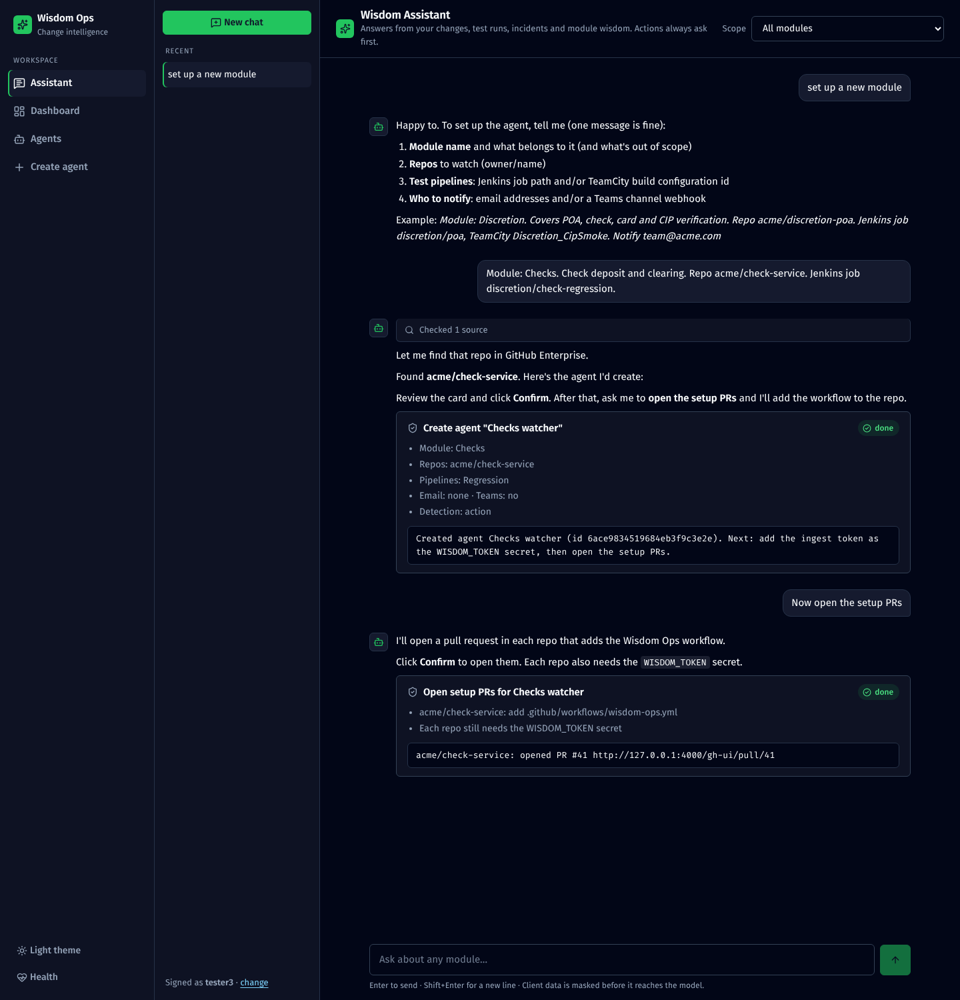

### Option B: the form

**Create agent** is a step-by-step wizard. The step list on the left shows where you are, what each step contains so far (e.g. "2 repos", "Off (optional)") and which steps are done or need attention. On a phone it becomes a progress bar.

1. **Module.** Name, and *what belongs to this module*. This is what Wisdom AI reads to decide whether a change matters, so name the sub-areas and say what's out of scope. *Required.*
2. **Repos.** Search GitHub Enterprise or type `owner/name`. For each repo, set:
   - **branches** (`main, release/*`);
   - **watched paths** (`src/**/poa/**`, `!**/*.md`);
   - **notes** on what matters there and who owns it.

   **Detection settings** (GitHub Action, poller or both, and the relevance threshold) sit under the repos, open by default, with sensible defaults (click the heading to collapse them); see [Relevance threshold](#relevance-threshold) below. *At least one repo is required.*
3. **Test pipelines.** Jenkins, TeamCity or GitHub Actions; see [Test pipelines](05-test-pipelines.md). *Optional.*
4. **Notifications.** Email recipients, a Teams workflow webhook URL, and when to alert on pipeline results. *Optional.*
5. **Incidents.** A ServiceNow encoded query, an optional work note, and a Splunk base search with its time window. *Optional.*
6. **Review.** Everything on one screen, with an **Edit** link per section. It also lists things people usually forget, such as no pipelines, nobody notified, repos without notes, or repos watching every file. These are warnings, not blockers. Click **Create agent** here.

How it behaves:

- **Next** checks the step before moving on. Problems show in a summary at the top, with links to the fields, and under each field. Optional steps that are empty show **Skip** instead of **Next**.
- **Your progress is saved in this browser as you type.** Come back later and the draft is restored, with a **Start over** button. The draft is cleared once the agent is created.
- **The browser's Back and Forward buttons move between steps**, and each step has its own link (`/agents/new?step=repos`).
- **Editing an agent uses the same steps**, but every step is open and **Save changes** is available from any step.

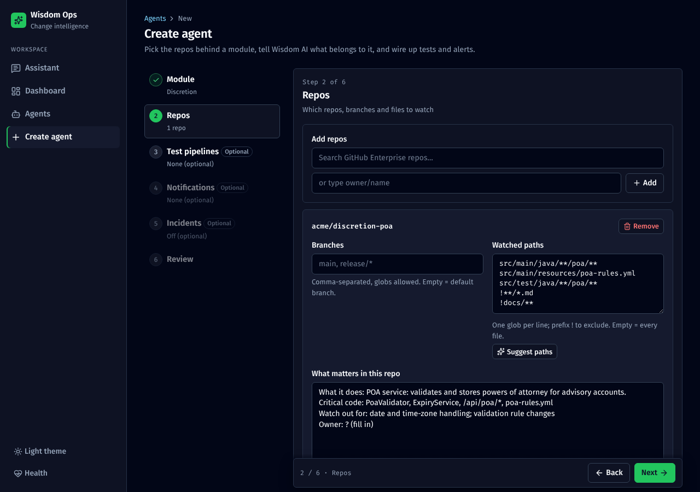

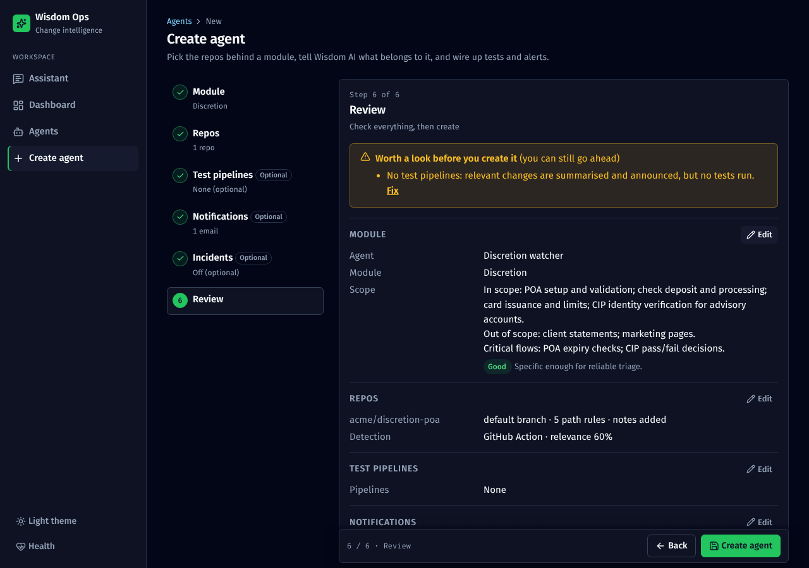

#### Relevance threshold

For every push that touches watched files, Wisdom AI answers two things: **does this change matter to the module** (yes/no), and **how sure is it** (0–100%).

- **Pipelines run and alerts go out only when it says yes *and* is at least as sure as the threshold.** At the default 60%, "yes, 75% sure" triggers everything; "yes, 50% sure" does not.
- **Nothing is lost below the threshold.** The change is still recorded, with its summary, on the agent's **Changes** tab, marked *not relevant*. You can open it, and **Re-run triage** works on it.
- **Tuning:**

  | Symptom | Change |
  |---|---|
  | Changes you care about end up as *not relevant* | Lower it, e.g. 40% |
  | Too many alerts or test runs for unrelated changes | Raise it, e.g. 75% |

- **Start at 60%.** During the dry-run week, look at what lands in *not relevant* and adjust.
- **A clearer module scope often fixes it better than the slider.** A specific *What belongs to this module*, with an out-of-scope line, makes Wisdom AI more confident in both directions.

The same explanation is shown as the hint under the slider in the form.

**Tell Wisdom AI when it's wrong.** Every change page has **Was this triage right? Yes / No** under the triage, and every incident page has a **Feedback** box for the real cause. These answers are how the team measures accuracy and decides whether to move the threshold; see [Evals](10-evals.md).

#### Let AI write the hard parts

The three fields that decide triage quality each have an AI button. Type something rough, or nothing, and AI turns it into the format triage works best with:

| Field | Button | What AI uses | What you get |
|---|---|---|---|
| What belongs to this module | ✨ **Improve with AI** | Your rough line, the module name, the repos added | **In scope / Out of scope / Critical flows**, plus questions about anything unclear |
| What matters in this repo | ✨ **Draft from repo** (or **Improve with AI** once you've typed something) | The repo's README, folder tree, recent commit messages, and the module scope | **What it does / Critical code / Watch out for / Owner** |
| Watched paths | ✨ **Suggest paths** | The folder tree, your repo notes and the module scope | Include and exclude globs, each checked against the real files: how many files each matches, and how many of the repo's files will be watched. Suggestions that match nothing are dropped. |

- **Nothing changes until you click Use this.** You can also click **Keep mine** or **Discard**, and you can edit the text afterwards. Nothing is saved until you save the form.
- **AI doesn't guess owners, team names or job names.** If it can't find them in your text or the README, it writes `Owner: ? (fill in)` and asks.
- **It's masked like every other Claude call**, so a client number pasted into the rough text never reaches Claude. Each suggestion, and whether it was used, is written to the audit log.
- **A label under each box says how good the text is** (*Empty*, *Too vague*, *OK*, *Good*) and what's missing. This check is instant and doesn't use AI.

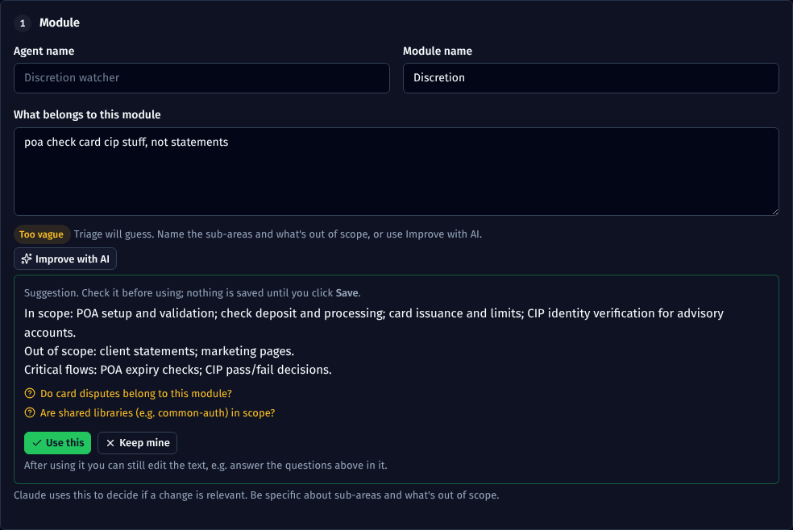

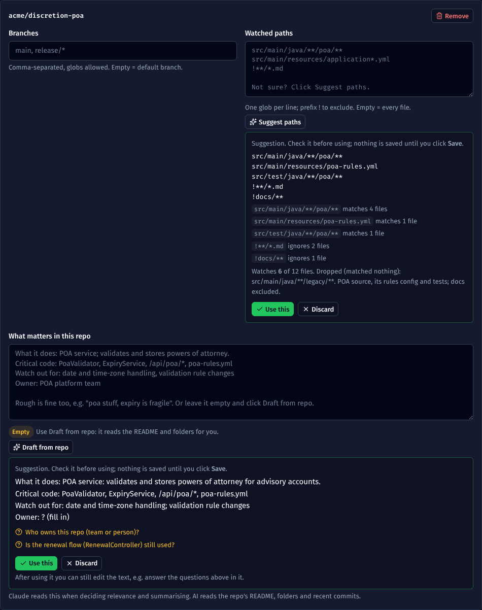

### Then install the workflow in each repo

On the agent's **Setup** tab:

1. Add a secret named `WISDOM_TOKEN` containing the ingest token (repo or org level).
2. If runners can't reach the app URL, set a variable `WISDOM_URL` to an address they can. Set `WISDOM_RUNNER` too if you need a self-hosted runner label.
3. Commit the generated file as `.github/workflows/wisdom-ops.yml`, or let the Assistant open the pull request.

It runs whenever code lands on a watched branch, including merged PRs. For what each line does, the gotchas (release branches, bot merges, `localhost` in the URL) and how to read the Actions log, see [The GitHub workflow](08-github-workflow.md).

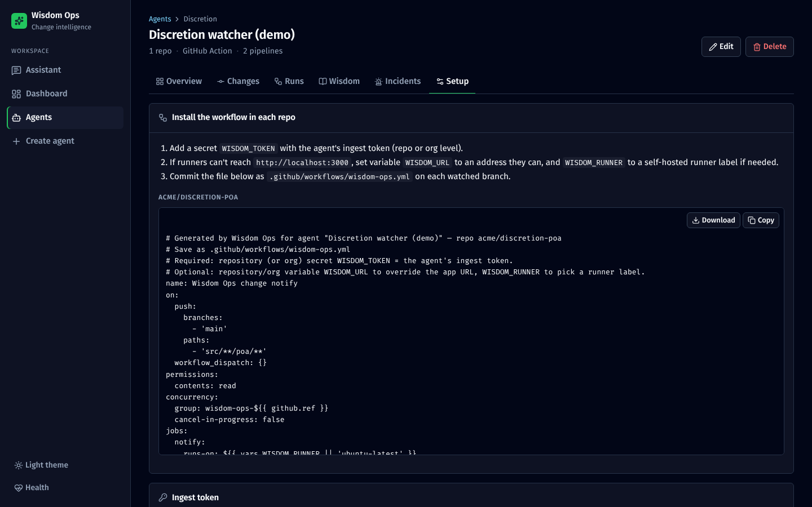

## 2. What happens on every push

Nobody does anything. Within about a minute:

- The **dashboard** shows the push with its risk and status:
  - **actioned**: relevant; tests and alerts went out;
  - **not relevant**: Claude judged it outside the module;
  - **path-filtered**: no watched file touched.
- The team gets an **email** and a **Teams card** with the summary, risk, test focus and pipelines started.
- The **change page** shows Claude's triage, the pipelines, notifications, commits, and the diff for each file.

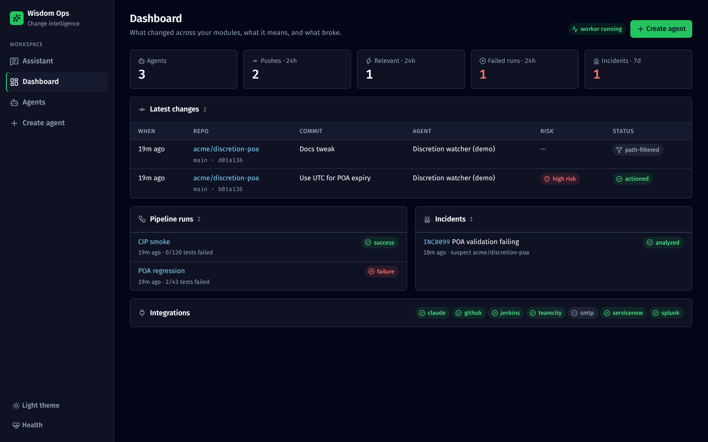

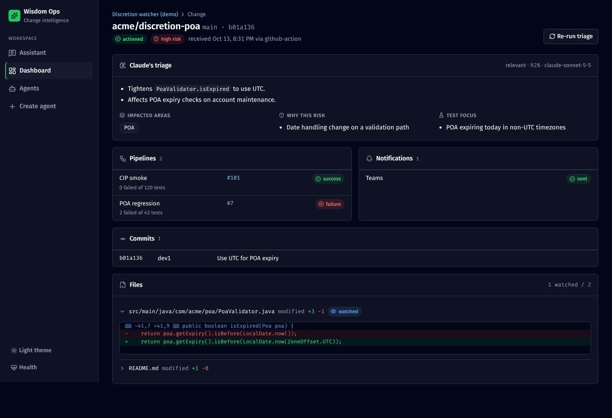

Each agent page has **Overview** (ask box, scope, repos), **Changes**, **Runs**, **Wisdom**, **Incidents** and **Setup** tabs.

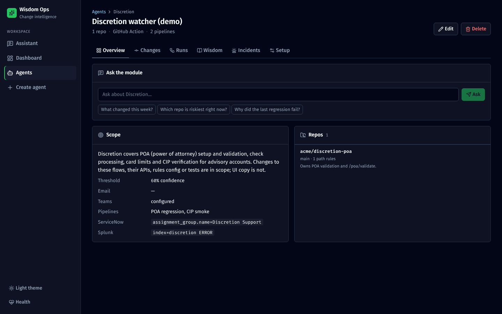

## 3. Test results

The **Runs** tab lists every build with its status, build link and failed/total tests. When a build fails, the agent's recipients get an alert that names the change that triggered it and who made it.

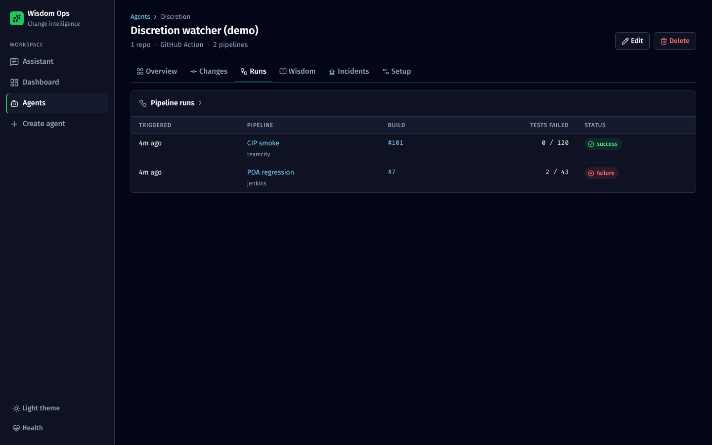

## 4. When production breaks

New ServiceNow incidents that match the agent's query are pulled automatically. You can also log one by hand on the **Incidents** tab, or ask the Assistant to analyse one.

### Setting it up (step 5 of Create agent)

**Pull incidents from ServiceNow.** The worker checks ServiceNow every few minutes (`SERVICENOW_POLL_MINUTES`) for **new** incidents matching your filter. Older tickets aren't pulled in.

- **Encoded query** decides which incidents belong to this module. Easiest way to get it: in ServiceNow, filter the Incident list as your team would (e.g. *Assignment group = Discretion Support*, *Active = true*), right-click the filter breadcrumb, choose **Copy query**, and paste it here, e.g. `assignment_group.name=Discretion Support^active=true`. Keep it tight: `active=true` alone would treat every incident in the firm as yours.
- **Post Wisdom AI's analysis back to the incident as a work note** adds the summary, likely cause and next steps to the ticket, so on-call sees it in ServiceNow. Work notes are internal, not visible to the end customer. This needs a service account that can write incidents. Start with it **off**, check quality for a week or two, then turn it on. It's never posted for manually logged incidents or when `DRY_RUN=true`.

**Search Splunk for evidence when an incident arrives.**

- **Base search** says *where* to look: index, sourcetype, app. For example, `index=discretion sourcetype=app_logs (ERROR OR WARN)`. Wisdom AI reads the incident and adds *what* to look for: up to 6 terms such as `PoaExpiredException` or `/poa/validate`. Test the base search in Splunk first; it should return your module's errors and little else.
- **Minutes before incident** (default 120): problems usually start before someone raises a ticket, so keep this generous. **Minutes after** (default 30): catches errors that kept happening.
- **Max events** (default 50): 50 well-targeted lines beat 500 noisy ones, and every line has to be masked and sent to Wisdom AI.

**Rollout order that works:** turn on Splunk first and test it with **Log incident** on 2–3 past incidents whose cause you already know. Then turn on ServiceNow with a tight query, and work notes last.

### Log incident (Incidents tab)

For incidents that don't come through ServiceNow: it isn't connected yet, the issue came in by email or chat, or you want to test the analysis on a past incident.

| Field | What to put |
|---|---|
| Incident number | The ServiceNow number if there is one (`INC0012345`), or any label (`EMAIL-0412`) |
| Opened at | When the problem **started**. The Splunk window and the change comparison are built around this time. Blank means now. |
| Short description | One line, e.g. *POA validation failing for advisors since 9am* |
| Error details | **Paste the exact error text**: stack trace, error code, endpoint, exception name. Wisdom AI picks the Splunk search terms from here: "POA broken" finds nothing, while "PoaExpiredException at /poa/validate" finds the right logs. Client data is masked, but don't paste more than you need. |

**Create and analyse** saves it and opens the incident page. The analysis appears within about a minute, on the worker's next pass, so the worker must be running. No work note is posted for these, because there's no real ticket to write to.

### What happens when an incident arrives

1. Wisdom AI picks search terms from the ticket.
2. Splunk is searched in the time window.
3. The log lines are masked.
4. Wisdom AI compares the ticket and logs with the last 14 days of relevant changes and any failed test runs.
5. You get a likely cause with a confidence level, evidence and next steps, by email, on Teams and, if turned on, as a work note.

### The incident page shows

- Claude's analysis in plain English;
- **likely causes**, each linked to the change and with a confidence level;
- evidence and suggested next steps;
- the Splunk query that was run and the matching log lines, with client data masked.

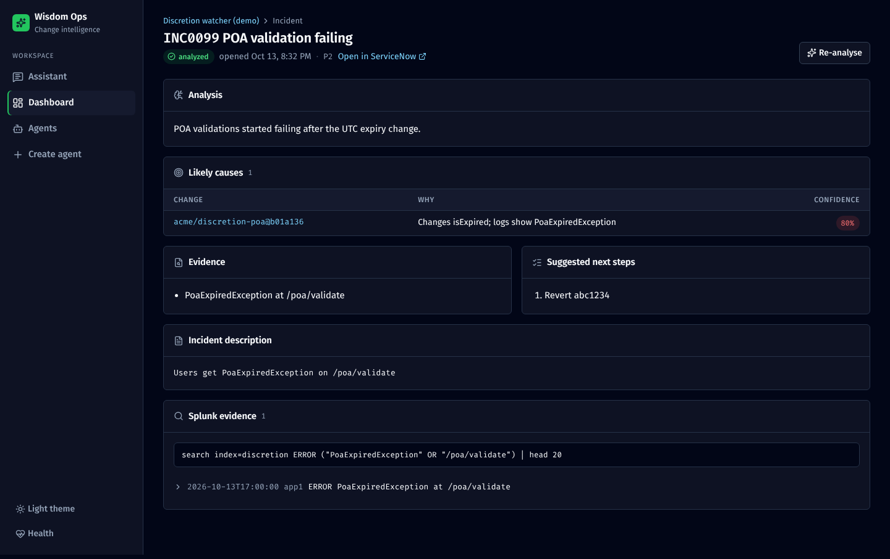

## 5. Module wisdom

Once a day, and on demand, Claude reads every repo in the module (README, file tree, recent commits, recent triaged changes) and writes:

- a module overview: how the repos fit together, where the risk is right now, and what to watch this week;
- per repo: purpose, key components, hotspots, risks and testing notes.

It's a quick way for a new joiner, or whoever is on call this week, to get up to speed.

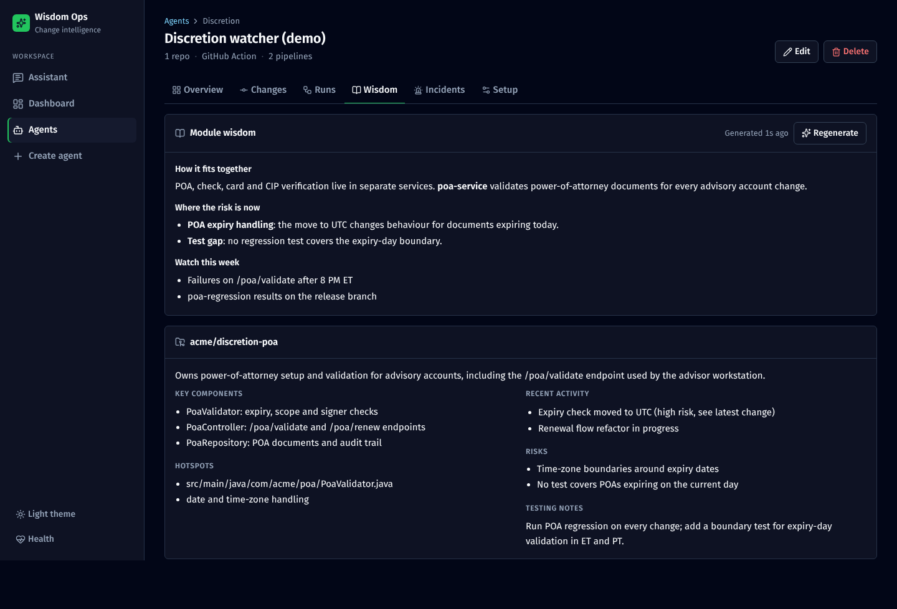

## 6. Ask the Wisdom Assistant

Pick a module under **Scope** and ask anything. For example:

- *What changed in CIP verification this week, and is anything risky going out Friday?*
- *Why did the last regression run fail?*
- *Summarise INC0099213 and its likely cause*
- *Re-run poa-regression for that change* (shows a Confirm card)
- *Add check-service to the Discretion agent* (shows a Confirm card)

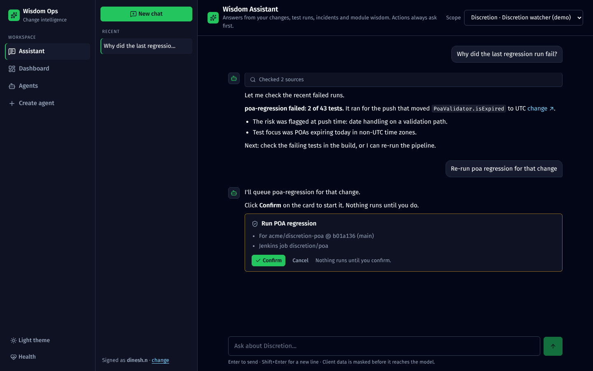

See [Wisdom Assistant](04-wisdom-assistant.md) for how it works and what it can do.

The app also has a light theme (sidebar toggle), and the chat works on a phone.

| Light theme | Phone |
|---|---|
| 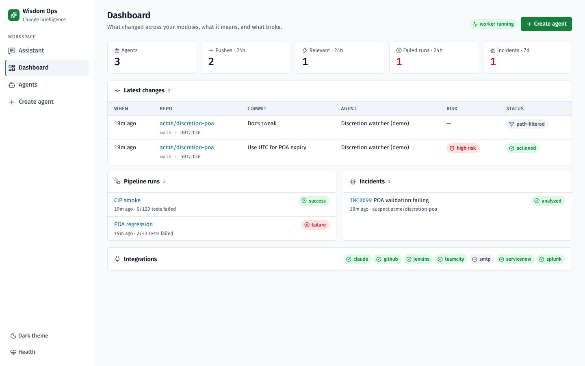 | 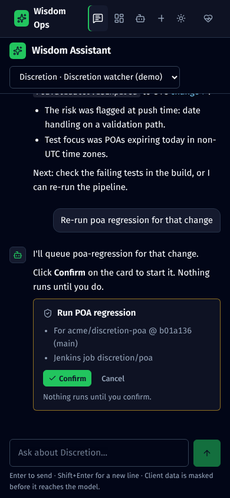 |
