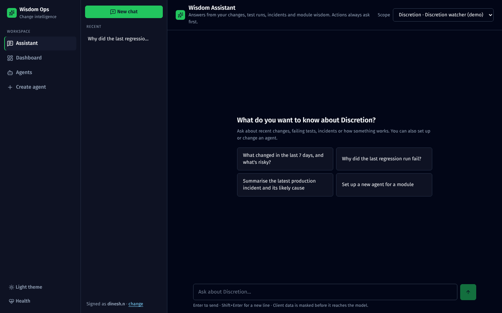

# Wisdom Assistant

The Assistant is the chat at **`/chat`**. It answers questions about changes, test runs, incidents and module knowledge, and can carry out a fixed set of actions after a person confirms them. Nothing needs to be installed.



## 1. Why the app calls an LLM

Each call has one narrow job. Claude reasons and writes; the code does everything else.

| Job | When | What Claude does | What stays in plain code |
|---|---|---|---|
| **Triage** | Every push that touches watched files | Decides relevance, rates risk, summarises, picks tests | Path filtering, dedupe, triggering builds, sending alerts |
| **Incident analysis** | New ServiceNow incident | Picks log search terms, correlates logs with recent changes, suggests next steps | Splunk queries, ServiceNow sync, work notes |
| **Wisdom** | Daily, per repo | Summarises purpose, hotspots, risks, testing notes | Fetching commits, README, file tree |
| **Assistant chat** | A user asks | Works out what to look up, then writes a cited answer | Every lookup, permission checks, redaction, audit |
| **Setup by chat** | "Set up an agent for…" | Turns the conversation into an agent config | Validating it, creating it, opening PRs |
| **Form helpers** | Someone clicks an AI button in the agent form | Cleans up the module scope, drafts repo notes from the README and folders, suggests watched paths | Reading the repo, checking each path against the real files, audit; nothing is saved without the person |

Claude never holds credentials and never calls Jenkins, GitHub or ServiceNow itself. It asks for a tool, and the server checks the request and runs it.

## 2. Where the knowledge comes from

```
Layer 1  Live records (MongoDB)      changes + triage, test runs, incidents + analyses,
                                     agent config (repos, owners, notes, scope)
Layer 2  Wisdom docs (MongoDB)       daily per-repo + module summaries ("long-term memory")
Layer 3  Systems, fetched on demand  GitHub (files, diffs), Jenkins / TeamCity (logs, tests),
                                     Splunk (search), ServiceNow (via synced incidents)
Layer 4  Team docs (not yet)         runbooks, Confluence → would need chunking + a vector index
```

- **Layers 1–3 need no embeddings.** One module's data is small and well structured, so a direct query is more accurate than vector search and is never out of date.
- **The knowledge base builds itself.** Every triage, test run and incident analysis is saved, so within a few weeks the Assistant knows the module's recent history in detail. Nobody maintains it by hand.
- **Layer 4 is the natural next step** if you want it to answer from runbooks or Confluence.

## 3. How it answers


The whole knowledge base isn't pasted into the prompt. Claude gets a list of tools and decides what to look up, one step at a time. It gets up to 8 rounds per question, and each round can run several lookups:

**Example:** *"Why did poa-regression fail last night?"*

1. `list_runs(pipeline="poa-regression", status="failure")` finds build #412, which failed 2 of 43 tests.
2. `get_change(run.change_id)` finds commit `a1b2c3d`, and the triage note that it moved `isExpired` to UTC.
3. `get_diff(change_id, "PoaValidator.java")` returns the exact lines.
4. Answer: *"poa-regression failed 2 of 43 tests on the push that moved PoaValidator.isExpired to UTC…"*, with a link to the change.

Earlier turns of the conversation are sent as plain text, without the tool traffic, so long chats stay cheap and quick.

### Tools

**Read tools** run immediately:

| Tool | Looks up |
|---|---|
| `list_agents`, `get_agent_config` | Agents and their configuration |
| `search_changes`, `get_change`, `get_diff` | Recorded pushes, triage, diffs |
| `read_repo_file` | A file in a watched repo (watched repos only) |
| `list_runs`, `get_build_log` | Test runs; Jenkins or TeamCity log tail |
| `search_incidents`, `get_incident` | Incidents and their analysis |
| `search_logs` | Splunk, limited to the agent's base search |
| `get_wisdom`, `get_stats` | Module summaries; counts for a period |
| `search_github_repos` | Repo search when setting up an agent |

**Write tools** only show a confirmation card:

| Tool | Does, after Confirm |
|---|---|
| `trigger_pipeline` | Starts one of the agent's pipelines for a change |
| `rerun_triage` | Re-queues a change for triage |
| `analyze_incident` | Re-runs the incident analysis |
| `refresh_wisdom` | Regenerates module wisdom |
| `create_agent`, `update_agent` | Creates or changes an agent; a new ingest token is shown once. The server checks every new repo exists on GitHub (and the token can see it) before the card appears and again on Confirm |
| `open_setup_prs` | Opens a PR in each repo adding the workflow |

Invalid input is sent back to Claude to fix before any card appears. Confirming claims the action atomically, so a double click can't run it twice. The card's status always comes from the server, never from the chat text.

## 4. Guardrails

| Concern | What's in place | Before production |
|---|---|---|
| Client data reaching the LLM | Every Claude call goes through one gateway (`src/lib/llm.ts`) that masks SSNs/ITINs, EINs, card, account and routing numbers, long ids, dates of birth, phone numbers, non-internal emails and secrets, plus your own patterns. This covers what users type, tool results, triage, incidents and wisdom. A test fails the build if anything bypasses it. See [Architecture → Masking](02-architecture.md#masking-client-data-before-claude) | Security to review the patterns against real samples; add internal ID formats to `REDACT_EXTRA_PATTERNS`; names and addresses aren't caught |
| Data leaving the network | All calls go to `ANTHROPIC_BASE_URL` if set | Point it at your approved gateway or deployment and get sign-off |
| Who can see what | Conversations are separated by display name only | Add SSO, then limit answers to modules the user can see |
| Accountability | `audit` collection: every question, lookup and action, with user, time and result size | Decide how long to keep it, and who can read it |
| Wrong answers | Must cite; says when nothing was found. Links to changes, incidents or agents that no lookup returned are removed from the answer, with a note, and logged in the audit (incident analysis also drops causes that cite unknown changes) | Have people check high-stakes conclusions; the team labels triage and incident results with the **Was this right?** buttons, and `npm run eval` measures accuracy against those labels ([Evals](10-evals.md)) |
| Prompt injection via diffs or logs | The system prompt tells Claude to treat tool results as data; actions always need a human to confirm | Same |
