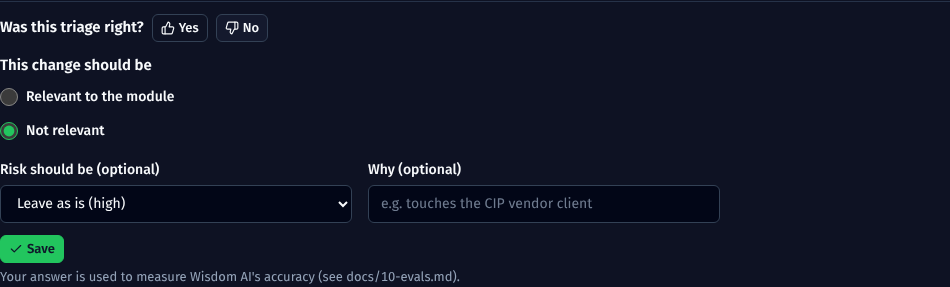
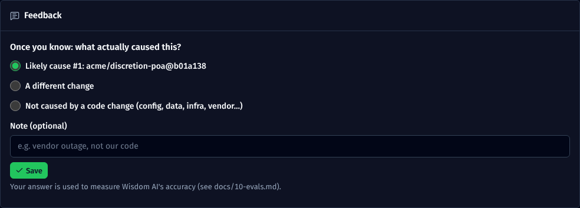

# Evals: measuring how good Wisdom AI is

Unit tests prove the code does what it's written to do. They can't tell you whether **Wisdom AI's decisions are right**, because the mock returns canned answers. Evals answer that, using real decisions judged by your team.

| Question | Eval |
|---|---|
| Does Wisdom AI miss changes that matter? Does it alert on ones that don't? | **Triage**: recall, precision, F1, risk agreement |
| When production breaks, does it name the right change? | **Incident analysis**: right cause at #1, in the top 3; doesn't blame code when code wasn't the cause |

## 1. Collecting labels (the team)

**On a change page** (open it from the alert's link): under the triage, **Was this triage right?**
- **Yes** records the AI's answer as correct, including the risk level.
- **No** opens a short form: should it be *relevant* or *not relevant*; optionally, what the risk should be; optionally, why. Then **Save**.



**On an incident page**, once the cause is known: **Feedback → what actually caused this?** Choose one of:
- one of the likely causes;
- a different change (paste its id from the change page's address);
- not caused by a code change (config, data, infrastructure, vendor…).



How labels work:
- Each answer is stored in the `eval_labels` collection, together with what the AI said at the time (model and prompt version) and who answered.
- **One label per change or incident; the latest wins.** Click **Change** to correct it.
- The name comes from the display name the person set in the Assistant.

**How many?** About **50 triage labels**, with a mix of relevant and not relevant, are enough to see a trend; 100+ to trust small differences. For incidents, every one where the cause became known is worth labelling.

**Best time:** the **dry-run pilot week**. Ask the module lead to spend 10 minutes a day labelling that day's changes.

## 2. Running the eval

```bash
npm run eval -- --stored          # score the answers the AI gave at the time; no AI calls, free
npm run eval                      # re-run the CURRENT prompt and model on the same items, and score that
```

| Option | Meaning |
|---|---|
| `--kind triage\|incident\|all` | What to evaluate (default all) |
| `--stored` | Use the stored answers instead of re-running |
| `--agent <id or name>` | One agent only |
| `--limit <n>` | Newest *n* labels per kind |
| `--min-recall 0.9` | Exit with code 1 if triage recall is below 90% |
| `--min-hit3 0.6` | Exit with code 1 if the incident top-3 hit rate is below 60% |
| `--out <dir>` | Report folder (default `eval-results/`, which is git-ignored) |

Each run prints a report and saves `eval-<time>.md` (for people) and `eval-<time>.json` (every row, for digging in).

**Re-runs call the real model** through the masking gateway (`src/lib/llm.ts`). They cost tokens, need the `ANTHROPIC_*` settings, and their results vary slightly from run to run. Incident re-runs reuse the Splunk evidence stored on the incident, so they're repeatable even when Splunk has moved on. Neither mode saves anything or notifies anyone.

## 3. Reading the report

**Triage.** The decision being scored is what the system **acted on**: *relevant **and** confidence ≥ the agent's relevance threshold*. A "relevant, 55%" answer with a 60% threshold counts as a miss, because nobody was alerted.

| Metric | Meaning | What to aim for |
|---|---|---|
| **Recall** | Of the changes that really mattered, how many it acted on | **Highest priority.** A miss is a risky change nobody was told about. Aim for 90%+ |
| Precision | Of the changes it acted on, how many really mattered | Low means noisy alerts and wasted test runs. 70%+ is workable |
| F1, accuracy | Overall balance | Trend over time |
| Risk agreement | Same risk level as the reviewer (where given) | 70%+ |
| Confidence when right / wrong | Wrong answers should come with lower confidence | A big gap means the threshold can do its job |

It also lists the **missed changes** and the **false alarms**, with links, to read through.

**Incident analysis.**

| Metric | Meaning |
|---|---|
| Right cause ranked #1 | The top suspect was the real cause |
| Right cause in top 3 | The real cause was among the first three suspects, which is useful for on-call |
| "Not a code change" handled correctly | For incidents the team marked as not caused by code, the AI didn't confidently blame a change (top confidence below 40%) |

## 4. What to do with the numbers

| You see | Try |
|---|---|
| Low recall: missed changes | Lower the agent's **relevance threshold**; make **What belongs to this module** more specific (in scope *and* out of scope); add repo notes naming the critical classes and endpoints |
| Low precision: noisy | Raise the threshold; add an **out of scope** line; narrow **watched paths** |
| Risk often disagrees | Add "watch out for" items to the repo notes |
| Incident cause not in the top 3 | Check the cause was triaged *relevant* (only relevant changes are suspects); turn on Splunk when available; ask on-call to paste exact error text in **Log incident** |

**Before changing a prompt or switching models:**
1. Run `npm run eval -- --stored` to get the baseline.
2. Make the change, and bump `TRIAGE_PROMPT_VERSION` in `src/lib/triage.ts` (or `INCIDENT_PROMPT_VERSION` in `src/lib/incidents.ts`).
3. Run `npm run eval -- --min-recall <baseline>`. If it fails, the change made things worse.

Each stored triage and analysis records its prompt version and model, so you can always tell which version produced which answer.

## 5. Limits

- **Labels are opinions.** Two reviewers can disagree on "relevant". Agree a rule of thumb in the team, e.g. "relevant = would you want to know about it before release?".
- **Small numbers swing.** With 20 labels, one change moves recall by 5 points. Look at trends, not single runs.
- **Re-runs aren't perfectly repeatable**, because the model's answers vary slightly. Compare averages over a few runs when the difference is small.
- **Incident labels need the cause to be known**, which can take days. Label when the post-incident review is done.
- It measures **triage and incident analysis only.** Assistant chat answers and AI form suggestions aren't scored yet; a fixed question set for the Assistant would be the next step.

## 6. Where it lives

| Piece | File |
|---|---|
| Feedback buttons | `src/components/Feedback.tsx` (on `changes/[id]` and `incidents/[id]`) |
| Labels API | `src/app/api/evals/labels/route.ts` (GET current label, POST save) |
| Metrics, runners, report | `src/lib/evals.ts` (metric functions are pure; tested in `tests/evals.test.ts`) |
| CLI | `scripts/eval.ts` → `npm run eval` |
| Storage | `eval_labels` (unique per kind + target) |
| Prompt versions | `TRIAGE_PROMPT_VERSION` (`src/lib/triage.ts`), `INCIDENT_PROMPT_VERSION` (`src/lib/incidents.ts`) |
