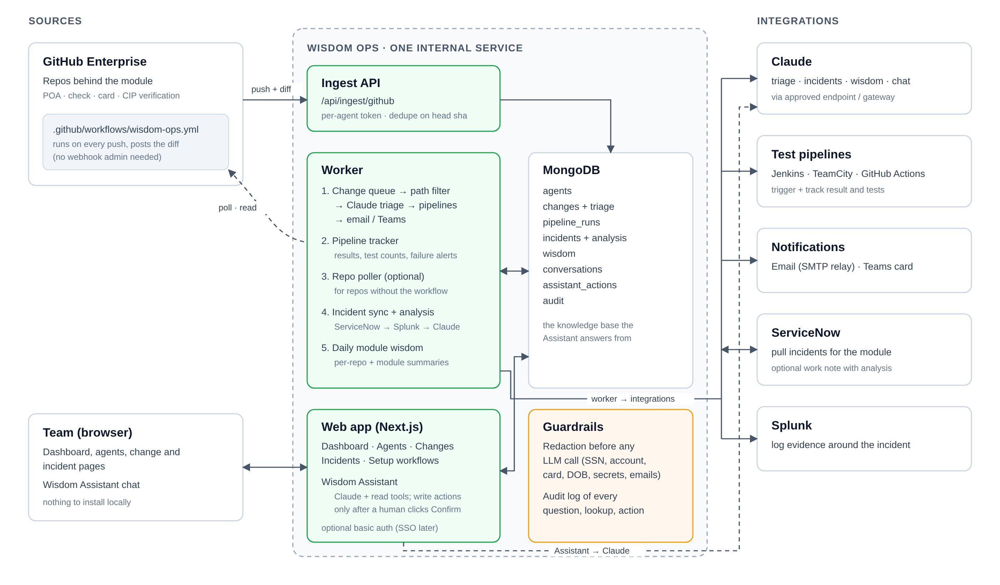
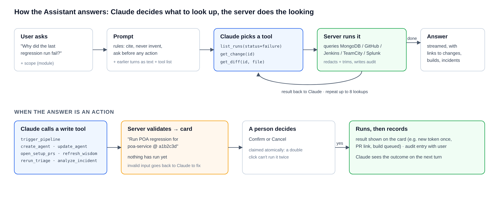
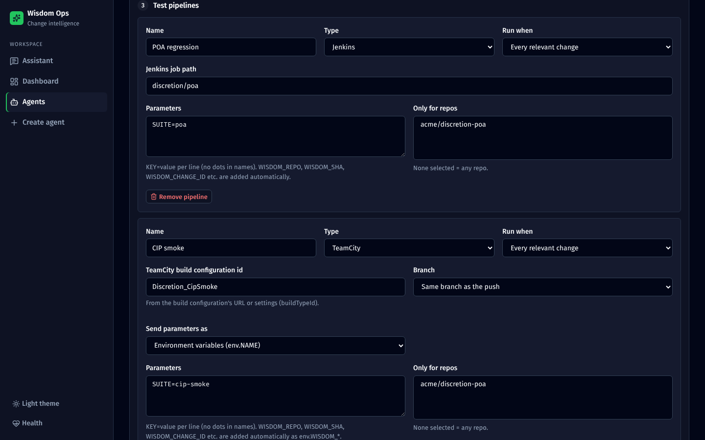

# Wisdom Ops: change intelligence for the discretion module

| Item | Detail |
|---|---|
| **Status** | Built and tested against mock services; ready for a pilot on real repos |
| **Owner** | [OWNER] |
| **Repo** | [LINK TO REPO] |
| **Demo** | [LINK TO INTERNAL URL] |

---

## Summary

The discretion module (POA, check, card and CIP verification) is built across many repos by different developers, and production issues come up daily. Wisdom Ops watches every push to those repos. Claude decides whether a change matters to the module, summarises it, rates the risk and names what to test. The app then triggers the right **Jenkins, TeamCity or GitHub Actions** tests and tells the team by **email and Teams**. When a **ServiceNow** incident arrives, it searches **Splunk** and names the recent change that most likely caused it.

Anyone can ask the **Wisdom Assistant** chat, *"Why did poa-regression fail?"* or *"What changed in CIP this week?"*, and get an answer that links to its sources. It can also take actions, such as re-running a pipeline or setting up a new module, once a person clicks **Confirm**. Developers install nothing.

---

## Why

When production breaks, the first hour goes on the same questions:

- What changed recently that touches this flow?
- Did the tests run on that change, and did they pass?
- Who changed it, and why?

Today the answers are spread across GitHub, Jenkins/TeamCity, ServiceNow and Splunk. Wisdom Ops collects them as changes happen, so the answers are ready before anyone asks.

---

## How it works

- **One internal service**: a web app plus a background worker, sharing one MongoDB.
- **No webhook admin needed.** Each repo gets one small GitHub workflow that posts each push to the app. Repos that can't have a workflow can be polled instead.
- **Claude reasons; the code acts.** Claude never holds credentials or calls other systems directly.

### On every push

1. A push to a watched branch is posted to the app and stored once.
2. **Path filter:** if no watched file changed, it stops here, with no LLM call.
3. **Claude triage:** is it relevant, how confident, a summary, the risk and why, what to test, which pipelines.
4. The configured **pipelines** run, with the repo, branch, sha and risk passed to each build.
5. **Email and Teams** go out with the summary and test focus.
6. Each build is **tracked to its result**, and a failure alert names the change and its author.

### When production breaks

ServiceNow incident → Claude picks log search terms → Splunk search around the time the incident opened → compared against 14 days of relevant changes → **likely cause with a confidence level**, evidence and next steps → email/Teams, plus an optional ServiceNow work note.

---

## Wisdom Assistant

### Why the app connects to an LLM

| Job | When | Claude does | Plain code does |
|---|---|---|---|
| Triage | Every push touching watched files | Relevance, risk, summary, tests | Filtering, dedupe, triggering, alerts |
| Incident analysis | New incident | Log terms, correlation, next steps | Splunk, ServiceNow, work notes |
| Wisdom | Daily | Per-repo and module summaries | Fetching commits, README, file tree |
| Assistant | A user asks | Decide what to look up, write a cited answer | Every lookup, redaction, audit |
| Setup by chat | "Set up an agent…" | Turn the conversation into a config | Validate, create, open PRs |
| Form helpers | AI buttons in the agent form | Clean up scope, draft repo notes, suggest watched paths | Read the repo, check paths against real files, audit |

### Where its knowledge comes from

1. **Live records** in MongoDB: changes and triage, test runs, incidents and analyses, agent configuration.
2. **Wisdom documents**: daily per-repo and module summaries.
3. **Systems, fetched on demand**: GitHub files and diffs, Jenkins/TeamCity logs, Splunk searches.
4. *(Next)* Team docs such as runbooks and Confluence, which would need a vector index.

There are no embeddings in v1. One module's data is small and structured, so direct queries are more accurate and never out of date. The knowledge base builds itself as changes, runs and incidents are recorded.

### How it answers

Claude gets a list of tools and decides what to look up, in up to 8 rounds per question (a round can run several lookups). The server runs each lookup, masks client data, trims the result and writes an audit entry. Answers stream back with links to changes, builds and incidents.

**Actions always need a person:** re-run a pipeline, re-run triage, analyse an incident, refresh wisdom, create or update an agent, open setup PRs. Each shows a card and only runs on **Confirm**.

### Setting up a new module from chat

---

## Module wisdom

Every day, Claude reads each repo in the module and writes:

- **Module overview:** how the repos fit together, where the risk is now, and what to watch this week.
- **Per repo:** purpose, key components, hotspots, risks and testing notes.

It's a quick way for a new joiner, or whoever is on call this week, to get up to speed.

---

## Test pipelines

| Type | Configure | Tracked |
|---|---|---|
| Jenkins | Job path | Queue → build → result, JUnit test counts |
| TeamCity | Build configuration id, branch, parameter prefix (`env.` / `system.` / plain) | State, status, test counts, build log |
| GitHub Actions | Repo, workflow file, ref | Run status and conclusion |

Each pipeline runs on **every relevant change**, or **only when Claude recommends it**, optionally limited to certain repos.

---

## Guardrails

| Concern | In place | Before production |
|---|---|---|
| Client data sent to the LLM | One gateway masks every Claude call, including what users type: SSN/ITIN, EIN, card, account and routing numbers, long ids, dates of birth, phones, non-internal emails, secrets, plus custom patterns. A build test blocks any bypass | Security review against real samples; names and addresses aren't caught |
| Data leaving the network | All Claude traffic goes through `ANTHROPIC_BASE_URL` | Approved gateway and sign-off |
| Access | Basic auth option; chat users enter a display name | Add SSO and per-module access |
| Accountability | Audit log of every question, lookup and action | Agree retention |
| Wrong answers | Must cite; links to records no lookup returned are removed, with a note; it says when nothing was found | People check before high-stakes actions; accuracy is measured from team feedback (`npm run eval`) |
| Unwanted actions | Every write needs Confirm; a double click can't run an action twice | Same |

---

## Setup checklist for a module

1. **Create the agent**, in the form or by asking the Assistant. Describe what's in scope and what isn't.
2. **Add `WISDOM_TOKEN`** as a repo or org secret.
3. **Merge the workflow PR** in each repo (the Assistant can open them).
4. **Run with `DRY_RUN=true` for a few days**, check the triage quality, then switch it off.
5. **Turn on ServiceNow and Splunk** for the module once the change history has built up.

---

## Open questions

| # | Question | Owner |
|---|---|---|
| 1 | Which Claude endpoint is approved for code and redacted logs? | [OWNER] |
| 2 | Where will it be hosted (Kubernetes namespace, MongoDB)? | [OWNER] |
| 3 | Is there a self-hosted runner that can reach the app, ServiceNow and Splunk? | [OWNER] |
| 4 | When can SSO be added? | [OWNER] |
| 5 | Can deploy events be fed in, so incidents are matched on deploy time? | [OWNER] |

---

## Links

- Detailed docs in the repo: `docs/` (overview, architecture, user guide, Assistant, pipelines, local testing, configuration, GitHub workflow, evals)
- Local demo, no credentials: `docs/06-local-testing.md`

---

### Importing this page into Confluence

1. Create a new page and paste this Markdown. Confluence Cloud converts most Markdown when you paste it. On Data Center, use the Markdown macro if your instance has it, or paste section by section.
2. Images don't come across with the text. Upload the PNGs from `docs/images/` as page attachments, then insert each one where its `` line was. The file names match.
3. Fill in the `[OWNER]` and `[LINK …]` placeholders, then delete this section.
